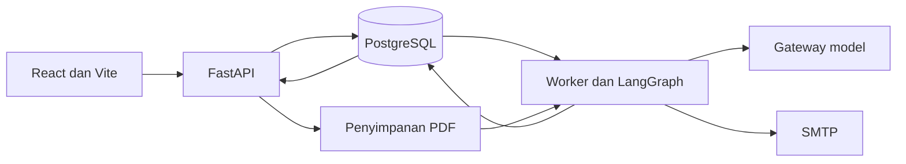

# Artha

Artha membantu staf impor memeriksa invoice sebelum menyiapkan draf PIB. Staf mengunggah PDF berteks, worker mengambil barang dan mencari kandidat kode HS, lalu model dapat meminta klarifikasi atau mengusulkan klasifikasi beserta kutipan katalog. Reviewer bisa menyetujui, mengubah, atau menolak usulan. Checklist dan estimasi pungutan dihitung dari data yang tersedia.

[Demo web](https://artha.rifqisetiawan.my.id) · [Dokumentasi API](https://artha.rifqisetiawan.my.id/docs) · [Panduan demo](docs/DEMO-GUIDE-ARTHA.md)

## Arsitektur



Analisis membaca dokumen, menyusun urutan pemeriksaan, mencari kandidat HS, memeriksa usulan, lalu menghitung checklist dan kesiapan. Pencarian web dan agent memakai ranking leksikal yang sama atas uraian resmi lima bab BTKI 2022. Jejak dan hasil disimpan di PostgreSQL, dengan pemulihan lewat job persisten. Simulasi aturan mengantrekan hitung ulang untuk kiriman aktif dengan awalan HS yang cocok.

## Menjalankan lokal

Butuh Python 3.12, PostgreSQL, dan Node.js 22. Buat database `imporjaga` dan `imporjaga_test`, lalu isi URL database di `.env`. Untuk menjalankan analisis, isi `LLM_GATEWAY_URL`, `LLM_GATEWAY_KEY` jika diperlukan, dan `LLM_MODEL` dengan model berizin yang mendukung tool calling pada endpoint kompatibel OpenAI. `LLM_MODEL_FALLBACK` opsional.

```sh
cp .env.example .env
python -m venv .venv
source .venv/bin/activate
pip install -e '.[dev]'
python -m scripts.setup_demo
npm --prefix frontend ci
npm --prefix frontend run build
uvicorn src.api.main:app --host 127.0.0.1 --port 8120
```

Pada terminal terpisah, jalankan `python -m src.worker.main` dan `python scripts/smtp_sandbox.py`. Buka `http://127.0.0.1:8120`. Setup lokal membuat akun `staf@mitrakemas.example`, `reviewer@mitrakemas.example`, dan `admin@mitrakemas.example` dengan sandi `imporjaga123`. Akun tersebut hanya untuk workspace fiktif. Set `DEMO_COMPANY_ID` dengan ID yang dicetak oleh setup jika admin perlu memuat ulang fixtures.

Untuk database yang sudah ada, jalankan `python -m scripts.migrate_runtime` sebelum memulai kode versi ini. Importer referensi dan fixtures bersifat aditif dan secara bawaan memakai database tes.

## Pungutan dan email

- Snapshot demo saat ini menyediakan tarif MFN berjejak sumber untuk HS `85365099`. Pos lain tetap perlu verifikasi. Perhitungan memakai status API perusahaan dan tarif PPN efektif untuk barang nonmewah dalam cakupan contoh. Kurs eksplisit mengalahkan kurs mingguan yang tercatat untuk tanggal WIB yang berlaku. Untuk FOB, isi ongkos angkut dan asuransi dalam mata uang invoice.
- Operator dapat mengimpor kurs mingguan yang sudah diperiksa lewat `scripts/import_reference_catalog.py --company-id ID --exchange-rates FILE.csv`. Header CSV ialah `currency,valid_from,valid_until,rate,source`, dengan rentang tanggal ISO dan tautan KMK untuk setiap baris.
- SMTP bawaan adalah sandbox. Untuk relay uji berizin, isi host, port, `SMTP_STARTTLS=true`, `SMTP_USERNAME`, `SMTP_PASSWORD`, `SMTP_FROM`, dan allowlist penerima. Penerima tetap berasal dari data kiriman, dengan pemeriksaan allowlist di worker.
- Cakupan referensi lartas yang belum diverifikasi tetap muncul di checklist. Draf PIB menampilkan kalkulasi tersimpan. Pengajuan PIB dilakukan di luar aplikasi.

## Verifikasi dan evaluasi

Gunakan database tes terisolasi yang baru dan sediakan ekstensi PostgreSQL `vector` untuk suite audit. Fixture tes menyiapkan skema dan data. Jalankan:

```sh
ruff check src scripts tests
pytest -q
npm --prefix frontend run build
PYTHONPATH=. python scripts/eval_hs.py --mode retrieval_only --out reports/eval_retrieval.json
PYTHONPATH=. python scripts/eval_hs.py --mode agent --out reports/eval_agent.json
```

Mode agent memakai gateway yang dikonfigurasi. Evaluasi memuat checksum katalog dan set uji, versi prompt, serta label yang dikeluarkan karena tidak ada di katalog. Label internal belum divalidasi independen. Lihat [catatan evaluasi](reports/README.md).

Versi ini mendukung PDF berteks. Pemindaian visual, pengambilan balasan lewat IMAP, dan pengiriman PIB ke CEISA berada di luar cakupan MVP.
